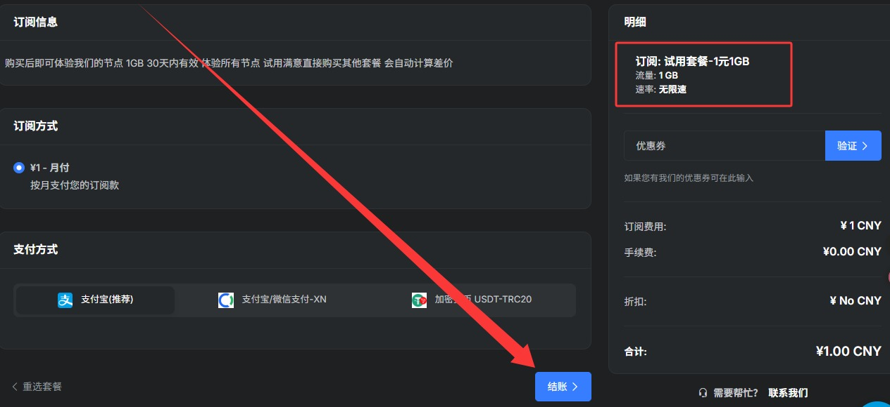
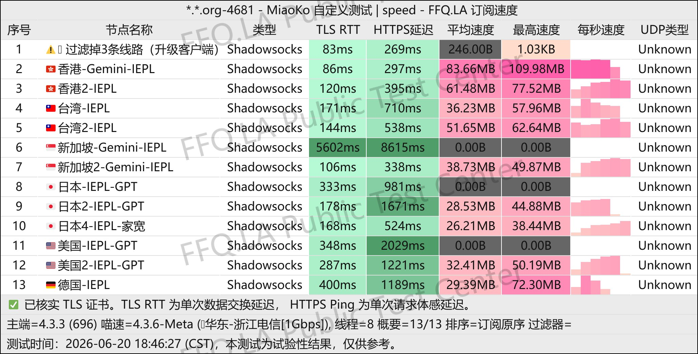
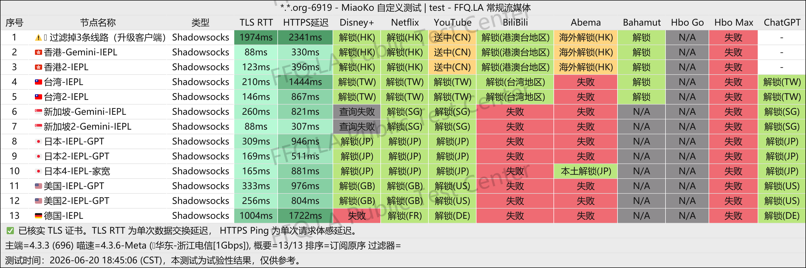
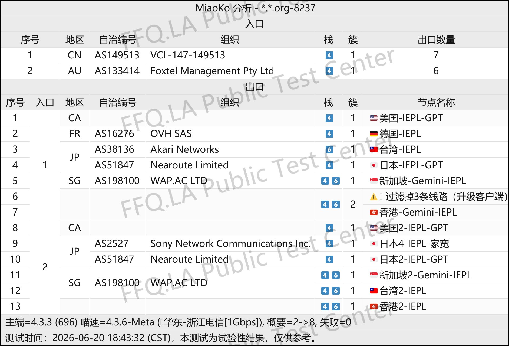

🇨🇳 中文 | 🇺🇸 [English](README_EN.md) | 🇷🇺 
[Русский](README_RU.md) | 🇮🇷 [فارسی](README_FA.md)

# bajie八戒机场官方地址(2026年11月9日更新)
bajie八戒机场官网地址</br>
最新地址01：[bajie.la](https://to.iix.im/bj01)</br>
最新地址02：[bajie.pro](https://to.iix.im/bj02)</br>
官方入口地址01：[bajie.pw](https://to.iix.im/bj03)</br>

2026最新好用的机场推荐与节点分享：[https://github.com/jdnei/JiChangTuiJian](https://github.com/jdnei/JiChangTuiJian)</br>
## Telegram VPN 机场福利社 #AD
[机场抽奖群](https://331024.de/archives/choujiang)｜[机场聊天群](https://331024.de/archives/choujiang)｜[机场体验群](https://331024.de/archives/choujiang)</br>

[https://331024.de/archives/choujiang](https://331024.de/archives/choujiang)

## 邀请码
`现在用此邀请码注册,可限时够买1元体验包（此套餐可能无法续费，以前出现过）`
```bash
sawTBTky 
```
  

## 优惠码/折扣码
`结束时间  2026/6/23 23:59`
```bash
26618
```
## 简介
“bajie八戒机场”是指一种提供VPN服务的俗称，这类服务旨在帮助用户突破网络限制，访问被屏蔽的互联网内容。以下是对“魔戒机场”及类似VPN服务的推广介绍。1元机场里，魔戒机场是代表，无有效期限制， 
## 优势
按量计费：与传统的包年包月模式不同，“bajie八戒机场”等服务通常采用按流量计费的方式，用户只需为实际使用的流量付费，无需担心到期时间。  
灵活性：这种计费方式适合流量需求不高的用户，例如浏览网页、收发邮件等。  
用户可以更自由的控制自己的消费。  
网络访问:提供给用户突破网络封锁，访问被限制网站的机会。  
## 套餐

| 套餐            | 流量         | 价格         | 付款周期               | 速率             | 同时在线设备 | 线路 / 节点        | 特色 / 备注                                                    |
| ------------- | ---------- | ---------- | ------------------ | -------------- | ------ | -------------- | ---------------------------------------------------------- |
| 试用套餐 · 1元1GB  | 1GB        | ¥1         | 月付，30天有效           | 不限速            | 未注明    | 全部节点           | 体验所有节点；升级其他套餐自动计算差价                                        |
| 70G · 按月计费    | 70GB / 月   | ¥12.9 / 月  | 月付 / 季付 / 半年付 / 年付 | 不限速            | 不限     | 跨境专线、运营商精品网络   | 低延迟；多月套餐一次性发放总流量，不按月重置                                     |
| 150G · 按月计费   | 150GB / 月  | ¥25.9 / 月  | 月付 / 季付 / 半年付 / 年付 | 不限速            | 不限     | 跨境专线、运营商精品网络   | 低延迟；多月套餐一次性发放总流量，不按月重置                                     |
| 300G · 按月计费   | 300GB / 月  | ¥38.9 / 月  | 月付 / 季付 / 半年付 / 年付 | 不限速            | 不限     | 跨境专线、运营商精品网络   | 低延迟；多月套餐一次性发放总流量，不按月重置                                     |
| 500G · 按月计费   | 500GB / 月  | ¥51.9 / 月  | 月付 / 季付 / 半年付 / 年付 | 不限速            | 不限     | 跨境专线、运营商精品网络   | 低延迟；多月套餐一次性发放总流量，不按月重置                                     |
| 1000G · 按月计费  | 1000GB / 月 | ¥103.9 / 月 | 月付 / 季付 / 半年付 / 年付 | 不限速            | 不限     | 跨境专线、运营商精品网络   | 低延迟；多月套餐一次性发放总流量，不按月重置                                     |
| 100G · 不限时间   | 100GB（总量）  | ¥34.8      | 一次性 / 不限时          | 不限速            | 不限     | 跨境专线、运营商精品网络   | 无到期时间，流量用完为止                                               |
| 220G · 不限时间   | 220GB（总量）  | ¥70.8      | 一次性 / 不限时          | 不限速            | 不限     | 跨境专线、运营商精品网络   | 无到期时间，流量用完为止                                               |
| 390G · 不限时间   | 390GB（总量）  | ¥118.8     | 一次性 / 不限时          | 不限速            | 不限     | 跨境专线、运营商精品网络   | 无到期时间，流量用完为止                                               |
| 800G · 不限时间   | 800GB（总量）  | ¥237.6     | 一次性 / 不限时          | 不限速            | 不限     | 跨境专线、运营商精品网络   | 无到期时间，流量用完为止                                               |
| 1260G · 不限时间  | 1260GB（总量） | ¥357.6     | 一次性 / 不限时          | 不限速            | 不限     | 跨境专线、运营商精品网络   | 无到期时间，流量用完为止                                               |
| 3T · 不限时间     | 3072GB（总量） | ¥799.2     | 一次性 / 不限时          | 不限速            | 不限     | 跨境专线、运营商精品网络   | 无到期时间，流量用完为止                                               |
| 独享节点 · 机房IP   | 1024GB / 月 | ¥200 / 月   | 月付 / 季付 / 半年付      | 50 Mbps        | 未注明    | IEPL 专线、独享出口   | 香港 / 新加坡 / 日本 / 台湾可选；不含公用节点；最多10个出口；增加节点 ¥40/月；多月套餐流量一次性发放 |
| 共享节点 · 动态家宽IP | 500GB / 月  | ¥150 / 月   | 月付 / 季付 / 半年付      | 100 Mbps（正文标注） | 未注明    | 日本家庭宽带 IP、多人共享 | 独立部署，非普通套餐节点；针对 Claude 优化；多月套餐流量一次性发放                      |

### 购买及流量规则

- **订阅叠加：** 新购买的订阅会叠加在现有订阅之上，不覆盖当前订阅。
- **扣量顺序：** 多份订阅按照到期时间由早到晚依次扣除流量。
- **多月套餐：** 季付、半年付、年付等套餐在购买时一次性发放全部流量（月流量 × 月数），不按月重置，到期后剩余流量作废。
- **不限时套餐：** 一次性购买，无到期时间限制，流量用完为止。
- **独享节点：** 需单独购买并部署，建议购买前提交工单咨询；从节点交付后开始计费，须提前15天提交续费工单，否则IP可能变动。
- **共享家宽节点：** 页面卡片标注“不限速”，但详情明确写有100Mbps带宽，表格按100Mbps记录。

特别注意： 多月套餐的“70GB/月、150GB/月”等表示流量计算基数，并非每月自动刷新。例如，70GB套餐购买季付后，一次性获得210GB，总流量可在套餐有效期内使用，过期作废。
## 📊 性能实测与分析
#### 1.晚高峰测速表现
  
#### 2.流媒体解锁报告

#### 3.落地入口分析

